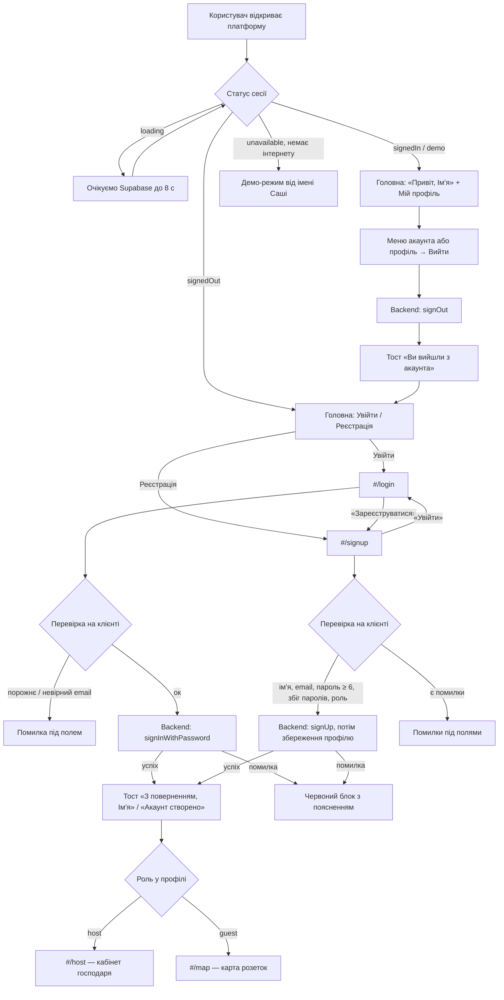

# User Flow: вхід, реєстрація, вихід

Схема для команди розробки. Код: `js/views/auth-page.js` (сторінки), `js/auth-forms.js` (перевірка полів, без DOM),
`js/auth.js` (сесія), `js/supabase.js` (Backend: Supabase Auth + таблиця `profiles`).

## Маршрути

| Адреса | Що показує |
|---|---|
| `#/` | Головна; у шапці й під головними кнопками — «Увійти» та «Реєстрація» (залогіненому — вітання й «Мій профіль») |
| `#/login` | Форма входу: email, пароль |
| `#/signup` | Форма реєстрації: ім'я, email, пароль, повтор пароля, роль (guest / host) |
| `#/map`, `#/spot/:id`, `#/calc` | Відкриті для всіх; бронювання потребує входу |
| `#/host`, `#/profile` | Потребують входу (інакше заглушка з кнопкою «Увійти») |

## Основний сценарій

## Дії залежно від статусу

| Статус | Шапка | `#/login`, `#/signup` | Бронювання, `#/host`, `#/profile` |
|---|---|---|---|
| `loading` | порожнє місце | «Завантаження…» | дія чекає на статус, потім як нижче |
| `signedOut` | Увійти, Реєстрація | форма | вікно входу (дію виконає після входу) |
| `needsProfile` | «Завершіть профіль» | «Завершіть профіль» (на `#/login`) | вікно з кроком профілю |
| `signedIn` | аватар + меню | «Ви вже в акаунті» + посилання | відкрито |
| `demo` | аватар + «(демо)» | «Ви вже в акаунті» | відкрито, від імені Саші |
| `unavailable` | Увійти, Реєстрація | «Вхід недоступний» + демо-режим | вікно входу з демо-режимом |

## Альтернативні сценарії

| Ситуація | Що відповідає Backend | Що бачить користувач |
|---|---|---|
| Неправильний пароль | `invalid_credentials` | «Невірний email або пароль» + «Немає акаунта? Зареєструватися»; поле пароля очищається |
| Незареєстрована пошта | та сама `invalid_credentials` | Те саме повідомлення. Supabase навмисно не розрізняє «немає акаунта» і «неправильний пароль» (захист від підбору пошт), тому підказка про реєстрацію показується в обох випадках |
| Повторна реєстрація | `user_already_exists` / `email_exists` | «Цей email уже зареєстровано — увійдіть» + посилання «Цей email уже є — увійти» |
| Пароль коротший за 6 символів | запит не надсилається | «Пароль має бути щонайменше 6 символів» під полем |
| Паролі не збігаються | запит не надсилається | «Паролі не збігаються» |
| Некоректний email | запит не надсилається | «Невірний формат email» |
| Забагато спроб | `over_request_rate_limit` | «Забагато спроб. Спробуйте за кілька хвилин» |
| Немає інтернету | збій fetch | «Немає з'єднання з інтернетом» + «Продовжити в демо-режимі» |
| Акаунт створено, профіль не збереглось | помилка запису в `profiles` | «Акаунт створено, але профіль не збережено» — повторне натискання пропускає створення акаунта й лише зберігає профіль |
| Вхід у акаунт без профілю (реєстрація колись обірвалась) | — | «Завершіть профіль» → ім'я та роль |

Повідомлення про помилки зібрані в `MESSAGES` у `js/auth.js`.

## Після успішного входу

1. Тост: «З поверненням, Ім'я!» (вхід) або «Акаунт створено. Вітаємо, Ім'я!» (реєстрація).
2. Перехід: роль `host` → `#/host`, інакше → `#/map`.
3. Шапка показує аватар з іменем і меню (профіль, вихід).
4. Дію, що чекала на вхід (наприклад, бронювання через вікно входу), виконано одразу.

## Вихід

Меню акаунта → «Вийти» або «Профіль» → «Вийти». Після виходу — тост і перехід на головну. Історія пошуку в браузері очищується (`createUserHistory.onReset`).
